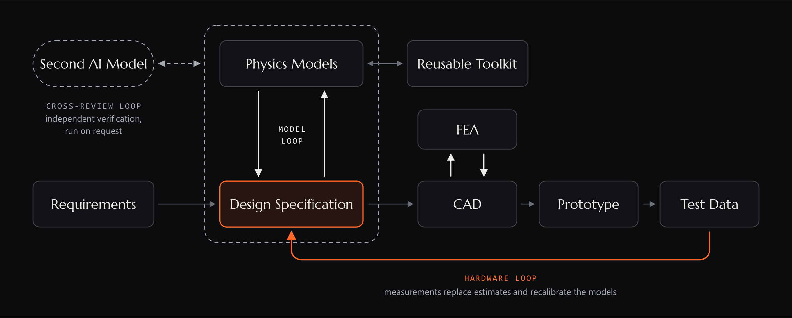
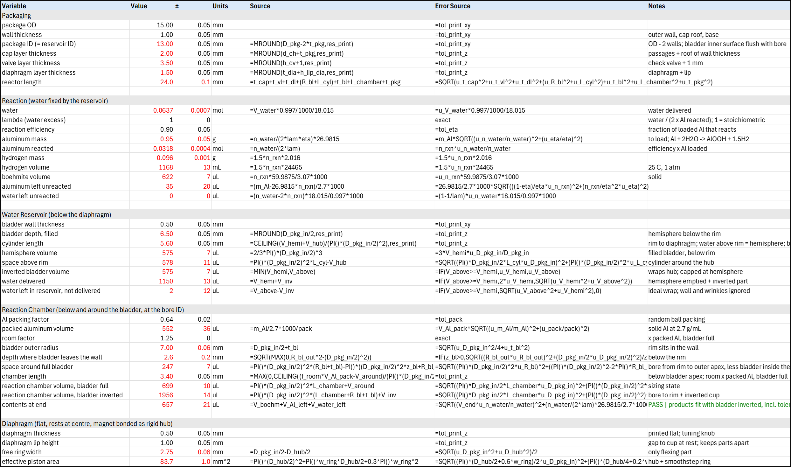
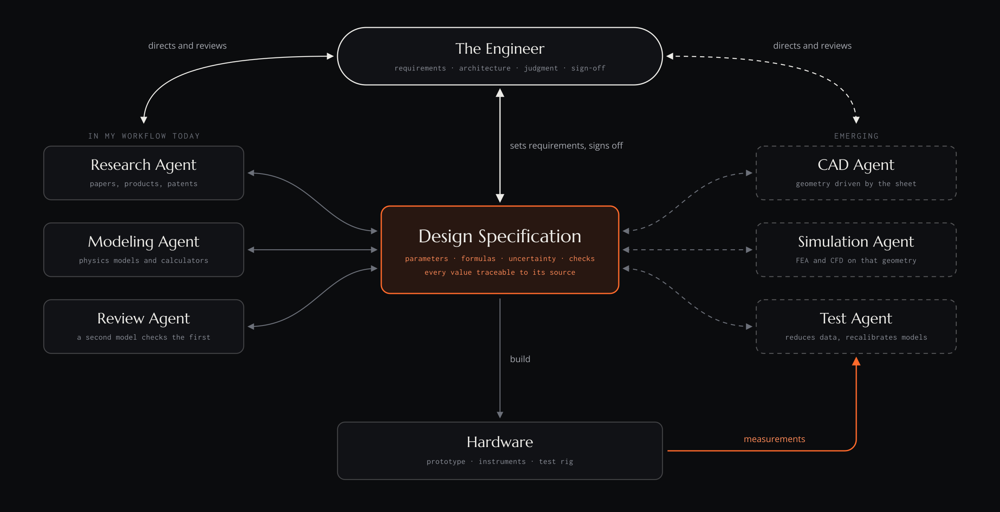

<!-- Rewritten November 2026 from Sam's "Engineering in an Age of Abundant Intelligence" draft and the workflow article. Citations are numbered and listed under References. -->

## The Future of Engineering When Intelligence Is Cheap

In 2023, frontier language models could not reliably add four-digit numbers. By 2025 they had won gold at the International Mathematical Olympiad, and in September 2026 an OpenAI system of roughly 10,000 parallel agents produced, in 88 hours, a resolution of the Navier–Stokes Millennium Prize problem, which mathematicians are now reviewing [1, 2]. Mathematics, like coding, is a wholly verifiable domain, so a model can learn through thousands of rounds of practice against an exact standard. AI research is largely verifiable in the same way, and as models begin to automate it, each generation helps build the next. This feedback loop, known as recursive self-improvement, means that even if current systems cannot produce meaningful scientific and engineering work, the systems they help create plausibly will. This idea is developed more fully in Dwarkesh Patel's recent essay titled "The avalanche that hit math is coming for AI development" [1].

The objections usually raised against AI in engineering, that it cannot reason spatially, invents numbers, or lacks judgment, sound much like those raised against AI in mathematics a few years ago. The computational core of engineering, including CAD, first-order analysis, finite element modeling and code, is likely to follow a similar trajectory.

The accelerating capabilities of AI therefore change not only how engineering is performed, but what becomes possible to engineer. Breakthroughs in materials, energy, electronics and manufacturing will spread across disciplines. Take, for instance, the possibility of a practical room-temperature superconductor. This one breakthrough alone would propagate a wave that fundamentally changes what is possible with modern electronics, and would require every product involving motors, power transmission, medical imaging or fusion reactors to go back to the drawing board. The consequences are combinatorial, with progress in one domain creating opportunities in many others.

Commoditized intelligence will not eliminate all the challenges of engineering, but it will change the bottlenecks. Work that can only be verified in the physical world will be the slowest to automate. Closing that loop autonomously requires capable robots, and robotics is itself a hardware problem bound by the same constraints. As generating solutions becomes inexpensive, the central challenges move toward formulating meaningful problems, managing physical constraints, and verifying theoretical solutions.

The engineer's role may therefore evolve from executing technical tasks toward directing increasingly powerful computational tools. Fundamental engineering principles remain important, not because humans will perform calculations better than the AI, but because those principles provide the framework for defining constraints, evaluating tradeoffs, designing the experiments that test a model, and interpreting the evidence that comes back.

The objective of my AI-in-the-loop design methodology is to explore this relationship between human judgment and machine intelligence in practice. While we aren't yet in a place where AI is fully capable of replacing engineers for computational work, the tools that exist are already extremely powerful if wielded correctly. As these tools continue to evolve, so will this framework, acting as a force multiplier for both the AI and me.

## An AI in the Loop Mechanical Design Workflow

This mechanical design workflow is intended to take an initial concept to the stage of a working prototype. The main benefit and challenge of a powerful AI agent is that it can write so much code and perform so many calculations that it becomes a monumental task just to verify the product. The key to a successful framework, then, is to make verification as easy and traceable as possible. I've developed this workflow over the last few years of experimenting with AI tools, and refined it in Professor Alex Slocum's precision product design class at MIT [3].

### Requirements

Every project starts as a conversation. Before anything is calculated, I use the AI to argue with me about what the system has to do and what constrains it, starting broad and challenging my assumptions. From there we look for prior art in papers, commercial products and patents.

## The specification sheet

The center of the workflow is a design specifications spreadsheet that works as a numerical twin of the design: geometry, loads and material properties come from requirements and constraints and flow into live calculations stored in the sheet.

Inputs are black and carry a source, which can be a datasheet, a requirement, or the reason I chose the value. Derived values are red, and beside each one Excel's FORMULATEXT function prints the formula that produced it, so the calculation can be read without clicking into a cell. Most values also carry an uncertainty, drawn from a separate sheet that budgets the error from fabrication, assembly, purchased parts and measurement. PASS/FAIL checks are integrated throughout the sheet so that key requirements can be verified at a glance.

## Physics models

Once the requirements and constraints are in the sheet, the AI and I build the physics models together. I identify the dominant effects and choose the approach, the AI drafts the derivations and calculations, and I check each result against limiting cases and physical intuition before it enters the sheet. Complex models that would take hours to derive by hand take minutes. Rather than committing early to one concept, several can be modeled against the same constraints and compared on equal footing. Upstream values can be easily changed and have their effects propagate throughout the design, allowing for rapid early iteration.

Excel is enough for most first-order models, but when a model outgrows it I move to Python, preferably Jupyter notebooks, which keep track of equations, assumptions and code. Calculations that generalize, such as a bolted joint, a shaft fit or a motor sizing, go into a verified toolkit once they have been checked, so each project starts further along than the last.

## Cross-review

The output of a single AI model is inherently low confidence without verification. Manual verification, however, can be extremely labor intensive and not without its own errors if the AI has just output 5,000 lines of code. Using a second model to peer review the work of the first with its own independent verification can help increase the confidence of the results and speed up verification. At the current level, this regularly catches errors that are subtle enough to go undetected at first glance.

## Outlook

In the near future the work of an engineer will look dramatically different from the past. Teams of agents will perform the primary computational execution, while the engineer frames each problem, sets constraints, and checks results before moving into fabrication and testing. The more work is delegated, the more important it becomes to audit efficiently, which is where this particular framework becomes helpful.

Intelligence is becoming cheap, but building in the physical world is not. As progress in verifiable domains compounds through recursive self-improvement, breakthroughs in materials, energy and electronics will arrive faster than they can be built into products. That work is bounded by experiments, manufacturing, and systems integration, which is where engineering judgment grounded in fundamentals will matter most.

## References

1. D. Patel, "The avalanche that hit math is coming for AI development," November 2026. [dwarkesh.com/p/rsi](https://www.dwarkesh.com/p/rsi)
2. A. Azhar, "Unsolved for 90 years, OpenAI says AI cracked Millennium Prize problem in 88 hours," *HPCwire*, September 2026. [hpcwire.com](https://www.hpcwire.com/aiwire/2026/09/16/unsolved-for-90-years-openai-says-ai-cracked-millennium-prize-problem-in-88-hours/)
3. A. Slocum, 2.70 FUNdaMENTALs of Precision Product Design, MIT. [web.mit.edu/2.70](https://web.mit.edu/2.70/)
