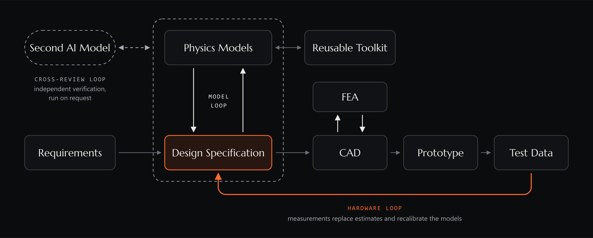
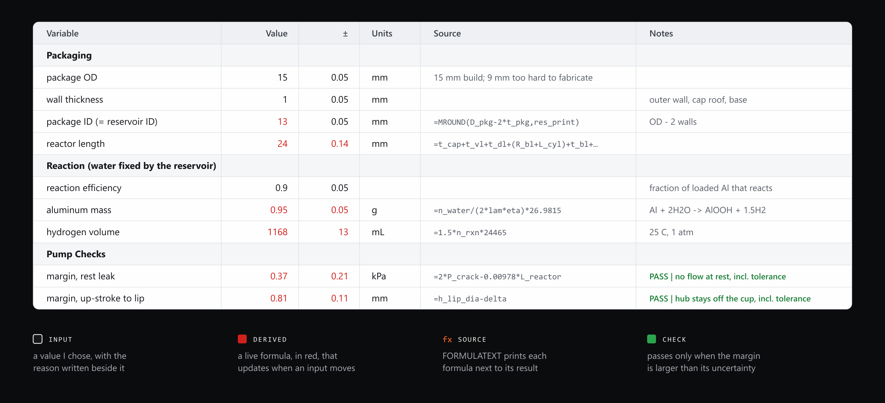
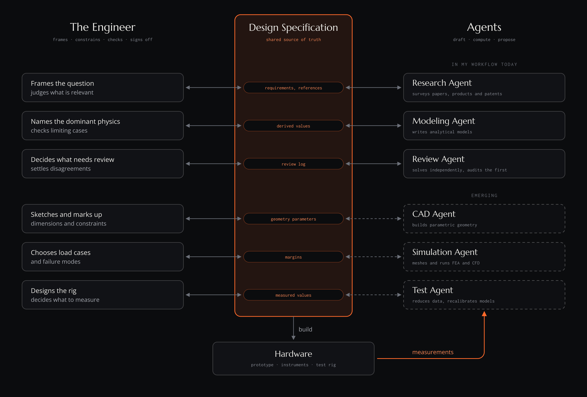

<!-- Rewritten November 2026 from Sam's "Engineering in an Age of Abundant Intelligence" draft and the workflow article. The reactor is described in outline only. Citations are numbered and listed under References. -->

## Abundant intelligence

In 2023, frontier language models could not reliably add four-digit numbers. By 2025 they had won gold at the International Mathematical Olympiad, and in September 2026 an OpenAI system of roughly 10,000 parallel agents produced, in 88 hours, a Lean-formalized resolution of the Navier–Stokes Millennium Prize problem, which mathematicians are now reviewing [1, 2]. Mathematics moved first because it is a wholly verifiable domain: every candidate proof can be checked, so a model can learn through thousands of rounds of practice against an exact standard [1].

Much of engineering is verifiable in the same sense. Geometric constraints, interference, dimensional consistency, conservation laws and finite-element margins can all be checked by a computer. The objections usually raised against AI in engineering, that it cannot reason spatially, invents numbers, or lacks judgment, closely resemble those raised against AI in mathematics a few years ago. The computational core of engineering, meaning derivation, modeling, simulation, CAD and code, is likely to follow a similar trajectory.

The accelerating capabilities of AI may therefore change not only how engineering is performed, but what becomes possible to engineer. As AI automates computation, simulation, optimization and scientific discovery, it will sharply reduce the cost of exploring new technological possibilities. Breakthroughs in materials, energy, electronics and manufacturing will propagate across disciplines; a practical room-temperature superconductor alone would send motors, power transmission, medical imaging and fusion magnets back to the drawing board. The consequences may be combinatorial, with progress in one domain creating opportunities in many others.

This abundance will not eliminate the challenges of engineering. It will shift them. The work that can only be verified in the physical world will be the slowest to automate: experiments run in serial time, consume material, and depend on physics that simulation and the written record capture poorly, such as contact, wear, manufacturing variation and biological response. Closing that loop autonomously requires capable robots, and robotics is itself a hardware problem bound by the same constraints. As generating and evaluating candidate designs becomes inexpensive, the central challenges move toward formulating meaningful problems, understanding interactions between subsystems, managing physical constraints, and verifying that theoretical solutions work in reality.

The engineer's role may therefore evolve from executing technical tasks toward directing increasingly powerful computational tools through the process of physical innovation. Fundamental engineering principles remain important, not because humans will always calculate or model better than machines, but because those principles provide the framework for defining constraints, evaluating tradeoffs, designing the experiments that test a model, and interpreting the evidence that comes back.

The objective of my AI-in-the-loop design methodology is to explore this relationship between human judgment and machine intelligence in practice. AI accelerates analysis, broadens design exploration and automates implementation, while engineering specifications, physical reasoning and experimental evidence provide a traceable foundation for decisions.

## The workflow

The workflow I've settled into covers the early part of design, from requirements to a model I trust enough to build from. It is organized around one constraint: an agent can produce numbers faster than I can check them, so the structure has to make checking cheap and leave the final word to hardware.

Most writing about working with AI comes from people who build software, where the loop is short. My test suite is a part that has to be printed, cured, assembled and measured, so a wrong number can hide for days before it shows up as a leak. I want the agent's speed without giving up the thing a mechanical engineer can't do without, which is knowing where every number came from.

As a running example I'll use a 15 mm aluminum-water reactor I'm developing, a capsule that meters water onto aluminum to make hydrogen for untethered soft robots. I describe it only in outline because the work isn't published yet.

### Requirements

Every project starts as a conversation. Before anything is calculated, I use the AI to argue with me about what the system has to do and what constrains it, starting broad and challenging my assumptions. From there we look for prior art in papers, commercial products and patents, because if someone has already built the wheel I would like to know before I design a worse one. When the requirements really do demand something new, I ask for several parallel concepts before converging on one.

In this stage the AI is a good sparring partner and a poor decision maker. It doesn't know which constraint I would trade away under pressure, and it has never been surprised by a prototype, so the requirements and the choice of architecture stay with me.

## The specification sheet

The center of the workflow is a spreadsheet I call the design specification. It works as a numerical twin of the design: every geometry, load, material property and assumption lives in it, every derived quantity is a live formula, and the CAD is built from it.

Inputs are black and carry a source, which can be a datasheet, a requirement, or the reason I chose the value. Derived values are red, and beside each one Excel's `FORMULATEXT` function prints the formula that produced it, so the calculation can be read without clicking into a cell. Most values also carry an uncertainty, drawn from a separate sheet that budgets the error from fabrication, assembly, purchased parts and measurement. The sheet ends in checks, each of which passes only when its margin is larger than its own uncertainty. I also keep the number of decimal places honest about how well a value is known, which needs watching because an agent will happily report a stiffness to six digits.

Two habits from precision machine design are built into it. The uncertainty sheet is an error budget, the same tool a machine designer uses to decide which error sources deserve attention, applied here to a whole device. The source column follows Slocum's FRDPARRC tables, which pair every functional requirement and design parameter with its analysis, references and risks, so that no number enters the design without a reason written next to it [3].

For the reactor, the sheet holds 58 inputs and 107 derived values across dimensions, forces, pump dynamics and the drive coil, and it ends in a summary page of 14 pass or fail checks. If I change one wall thickness, everything downstream moves and the summary tells me what broke.

An agent could build me an interactive app with sliders in the same time, and those interfaces are popular because they make good demos, but they hide the arithmetic. A spreadsheet shows its work, so when a number looks wrong I can follow it back through every cell that fed it, and so can anyone I hand the file to. The more of the arithmetic an agent writes, the more that matters.

## Agent-built models

With the specification in place, the agent builds the physics. I describe the dominant effects and it writes the model: stoichiometry for the reaction, the bending and stretching of a diaphragm, pressure drops through a valve, the force between a coil and a magnet, and the heat the coil sheds. I could derive each of these by hand from a textbook, slowly, but the agent drafts them quickly enough that I can explore a design space instead of defending the first design that works.

Cheap models also change how I choose an architecture. Hydrogen can power a soft robot in several ways: the gas can expand directly as the working fluid, a fuel cell can convert it to electricity that drives a pump, or the two can be combined. When each model costs an afternoon, I don't have to commit to one of these early and defend it. I can have the agent build all of them against the same constraints from the sheet and see which combinations of physics make sense at a given size and duty cycle.

Excel has been enough for everything in the reactor. When a model outgrows it I move to Python, and there I prefer Jupyter notebooks to loose scripts for the same reason I prefer spreadsheets to apps: a notebook keeps the equations, assumptions, code and outputs together in the order they were computed.

Some of these calculations are useful beyond one project. Once one of them has been checked, such as a bolted joint, a shaft fit or a motor sizing, it goes into a toolkit and comes along to the next project. Over time the toolkit is where the speed compounds, because each verified tool is one less thing an agent has to derive from scratch and one less thing I have to check again.

## Cross-review

The output of a single AI model is low confidence, however sure it sounds, so for anything that matters I bring in a second model from a different lab. It first works out how it would attack the problem without looking at the existing solution, and only then reviews that solution critically. The two models keep a shared review log in the project folder, which lets either one pick up where the other left off. Because all of this costs time and money, it runs only when I ask.

An early version of the reactor model was written in Python, and it ran without complaint. When the second model reviewed it, it found six groups of defects and reproduced each one before reporting it. A sensitivity study was returning zeros because it looked up results by display labels that had since been renamed. The water dose was computed and then never passed to the gas generation model, so a 1 ms pulse and a 100 ms pulse gave identical hydrogen curves. The dose formula also jumped by a factor of two at one particular pulse width. When the first model looked at the evidence, it agreed with all three.

None of those errors would have crashed anything, and each would have produced a plausible plot. That is why the working agreement both agents now follow includes the line that numerical agreement and passing checks are not physical validation.

Precision metrology offers a useful comparison. Donaldson reversal separates a spindle's error motion from the form error of its test ball by measuring twice, with the ball and probe rotated 180 degrees, so that one error changes sign and the other does not [4]. Cross-review is a loose analogue for models: where two independently trained models disagree, at least one is wrong, and the disagreement shows where to look. The analogy has a limit, because models from different labs learn from much of the same text and their errors are not fully independent.

## Hardware in the loop

Two models agreeing still isn't the same as being right, which leaves hardware as the outermost loop and the only one that validates anything. It is also the part of engineering I expect to remain hardest to automate.

What this loop looks like changes with every project, but in all of them every estimate in the specification is labeled as an estimate, and testing replaces estimates with measurements. In the reactor's error budget, for example, the print tolerance began as a guess, and a small printed coupon of pins, holes and thin walls turns that guess into a number with scatter. Once a measurement goes into the sheet, the uncertainty on everything downstream of it shrinks or grows, and the checks re-evaluate themselves.

When a test disagrees with a prediction, the useful response is to find which assumption failed, change it in the sheet where every downstream number can see it, and decide what to measure next.

## CAD and design intent

The transition to AI-assisted engineering also demands a different relationship with our tools. Conventional CAD requires the engineer to translate intent into a sequence of explicit modeling operations. AI-native environments could reverse this, allowing engineers to express intent through language, sketches, dimensions and physical constraints while AI translates that information into editable, verifiable models.

Current tools are partway there. I've found AI useful for standard parts such as a bracket or a simple housing, which it can model quickly from a drawing, but for complex parts spatial reasoning is still the weak point. Part of that weakness, I suspect, is bandwidth: a three-dimensional layout is hard to convey in text, which is why engineers sketch and mark up drawings rather than describe geometry in paragraphs.

In the interface I'd want, I sit at a desk with a text window and a drawing tablet. I upload reference drawings for the purchased parts, describe the object in a few sentences, and sketch the rough layout. The agent compiles that into a parametric model, which appears on the tablet, and I edit it the way I'd mark up a print: circling a flange and writing "stiffer, no more than 20 g," drawing a dimension that should be fixed, or drawing a line between two bores to say they stay coaxial.

Each mark should become an explicit constraint with a record of where it came from. The agent should keep a parametric record of intent, separate my requirements from its own assumptions, and return proposed edits with their consequences for me to accept or reject. A model that can't be modified, analyzed or traced back to its requirements isn't worth much, however good it looks. The specification sheet is how I'm preparing for that: if every dimension already lives in one traceable place, the sheet is the natural place for an agent's proposals to land.

## Outlook

In this division of labor the agents do most of the execution, and the engineer frames each problem, sets its constraints, checks what comes back, and signs for the result. The more work I delegate, the more I need to audit it quickly, which is why the specification sheet stays plain and why I don't hand over work I can't check.

The ultimate goal is not simply to design existing things faster, but to make it practical to investigate systems that would previously have been too complex, costly or time-consuming to develop.

## References

1. D. Patel, "The avalanche that hit math is coming for AI development," November 2026. [dwarkesh.com/p/rsi](https://www.dwarkesh.com/p/rsi)
2. A. Azhar, "Unsolved for 90 years, OpenAI says AI cracked Millennium Prize problem in 88 hours," *HPCwire*, September 2026. [hpcwire.com](https://www.hpcwire.com/aiwire/2026/09/16/unsolved-for-90-years-openai-says-ai-cracked-millennium-prize-problem-in-88-hours/)
3. A. Slocum, "FRDPARRC," MIT 2.007 Design and Manufacturing I, 2009. [ocw.mit.edu](https://ocw.mit.edu/courses/2-007-design-and-manufacturing-i-spring-2009/resources/mit2_007s09_rec05_frdparrc)
4. R. Grejda, E. Marsh and R. Vallance, "Techniques for calibrating spindles with nanometer error motion," *Precision Engineering* 29, 113 (2005). [doi:10.1016/j.precisioneng.2004.05.003](https://doi.org/10.1016/j.precisioneng.2004.05.003)
