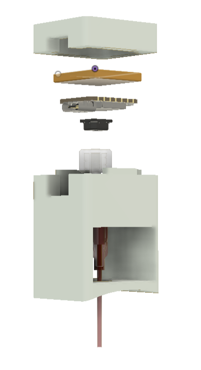
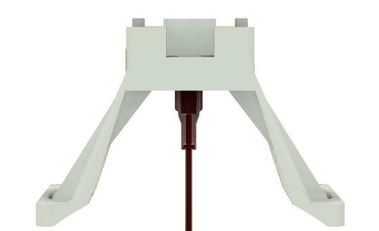
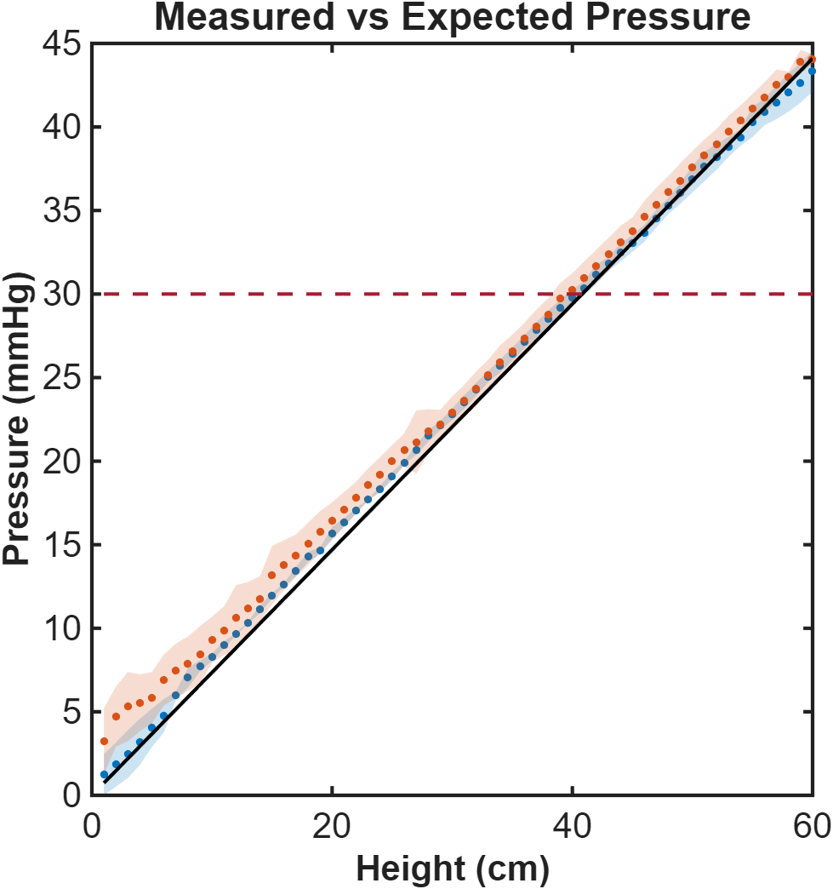
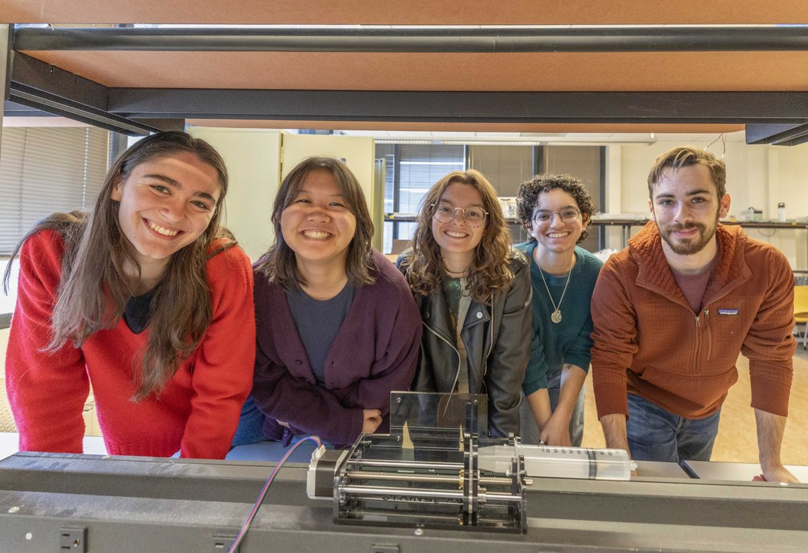

<!-- Draft carried over from the old site. Rewrite in your own words.
     The old battery-plot image was actually the team photo; there is no battery plot yet. -->

## The clinical gap

Acute compartment syndrome follows fractures, burns and crush injuries. Pressure rises inside a muscle compartment and chokes off perfusion. Above roughly 30 mmHg the treatment is an emergency fasciotomy; missed, the endpoint is tissue death and amputation. Onset can be silent, especially under regional anesthesia, when pain is masked.

The standard tool, the Stryker ICP monitor, costs about $3,000, takes one reading per needle insertion, and has no alarms. Our clinical proposer asked for the missing device: **cheap, continuous, and loud when it matters.**

## The device

An indwelling 20-gauge flexible catheter connects through a luer lock to a pressure transducer on the patch. An ESP32 samples it, median-filters the signal, and streams readings over Bluetooth Low Energy to a phone app that plots the trend and raises audible and visual alarms at a programmable threshold. A 110 mAh battery runs about 20 hours.

## Validation

We validated accuracy against a hydrostatic water column, where pressure is known exactly from ρgh. The device read **within 1 mmHg at the 30 mmHg diagnostic level**, with no systematic difference between needle and catheter delivery.

To test in something closer to tissue, we built a phantom compartment (ballistics gel over an inflatable pouch in a nylon sleeve) and tracked programmed pressure ramps through the full needle-to-app chain. Battery endurance testing confirmed 20 h 13 min of continuous sampling.

## Engineering notes

- **Needle fabrication.** Test needles were modified to mimic the Stryker non-coring geometry, tip soldered shut and side ports cut, so tissue doesn't plug the lumen.
- **Signal chain.** One sample per minute with a rolling median rejects motion spikes without smearing real trends.
- **Beyond the leg.** The same platform extends to abdominal and intracranial pressure.

## Where it stands

The prototype meets its functional requirements on the bench. Next steps are animal and clinical testing, head-to-head comparison with the Stryker and MY01 devices, and motion-artifact filtering for ambulatory patients.

