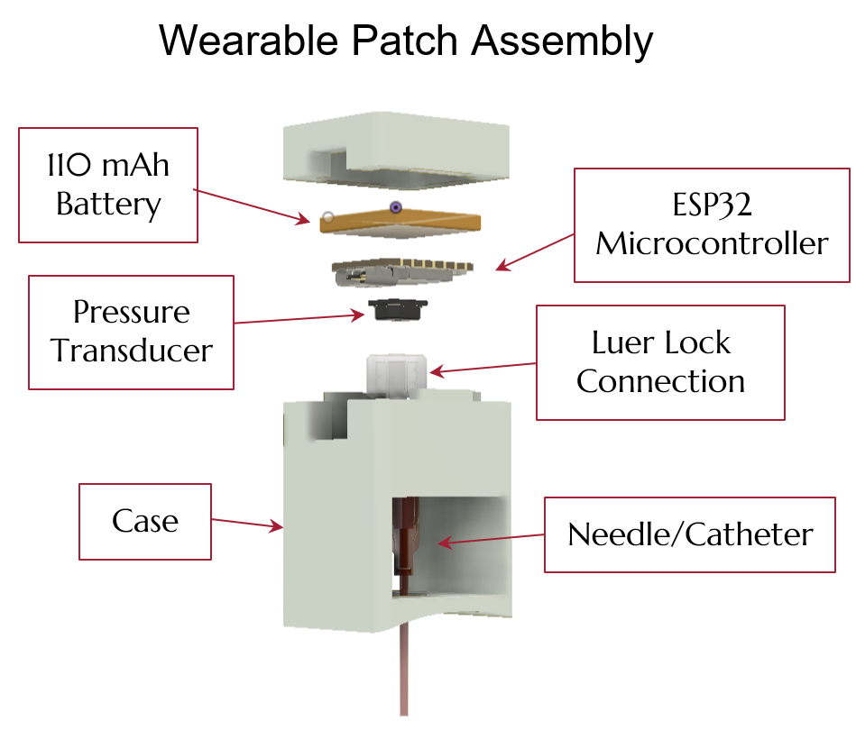
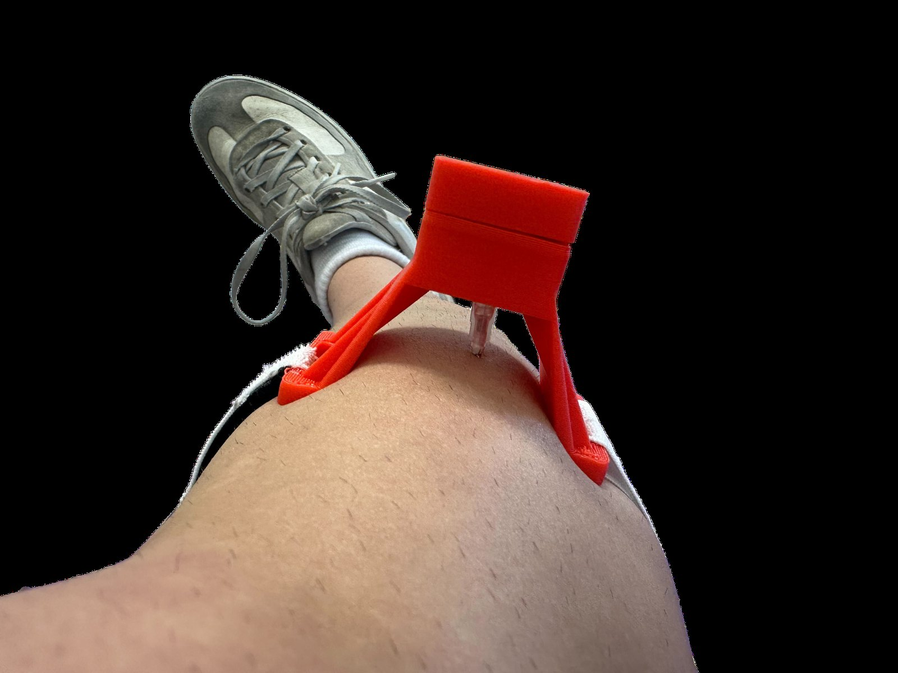
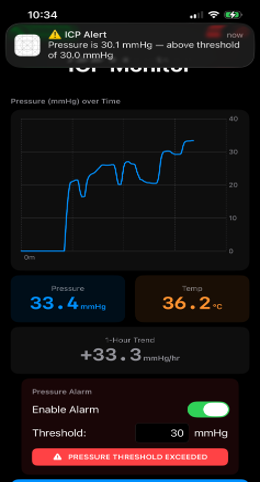
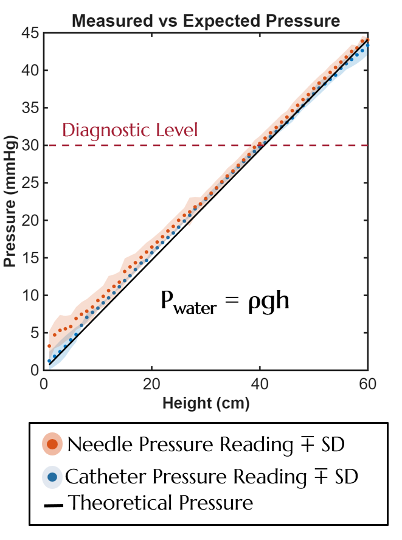

<!-- Draft carried over from the old site. Rewrite in your own words.
     Older renders, the old validation plot and the team photo are in _unused/. -->

## Compartment syndrome

Acute compartment syndrome follows fractures, burns and crush injuries. Pressure rises inside a muscle compartment and chokes off perfusion. Above roughly 30 mmHg the treatment is an emergency fasciotomy; missed, the endpoint is tissue death and amputation. Onset can be silent, especially under regional anesthesia, when pain is masked.

The standard tool, the Stryker ICP monitor, costs about $3,000, takes one reading per needle insertion, and has no alarms. Our clinical proposer asked for a device that is **cheap, continuous, and loud when it matters.**

## Wearable patch

An indwelling 20-gauge flexible catheter connects through a luer lock to a pressure transducer on the patch. An ESP32 samples it, median-filters the signal, and streams readings over Bluetooth Low Energy. A 110 mAh battery runs about 20 hours. The housing curvature matches the limb, and the patch mounts with adhesive and a strap.

A phone app plots the pressure trend and raises an audible and visual alarm when pressure crosses a programmable threshold.

## Validation

We validated accuracy against a hydrostatic water column, where pressure is known exactly from ρgh. The device read **within 1 mmHg at the 30 mmHg diagnostic level**, with no systematic difference between needle and catheter delivery.

To test in something closer to tissue, we built a phantom compartment (ballistics gel over an inflatable pouch in a nylon sleeve) and tracked programmed pressure ramps through the full needle-to-app chain. Battery endurance testing confirmed 20 h 13 min of continuous sampling.

## Design details

- **Needle fabrication.** Test needles were modified to mimic the Stryker non-coring geometry, tip soldered shut and side ports cut, so tissue doesn't plug the lumen.
- **Signal chain.** One sample per minute with a rolling median rejects motion spikes without smearing real trends.
- **Beyond the leg.** The same platform extends to abdominal and intracranial pressure.

## Next steps

Animal and clinical testing, head-to-head comparison with the Stryker and MY01 devices, and motion-artifact filtering for ambulatory patients.
