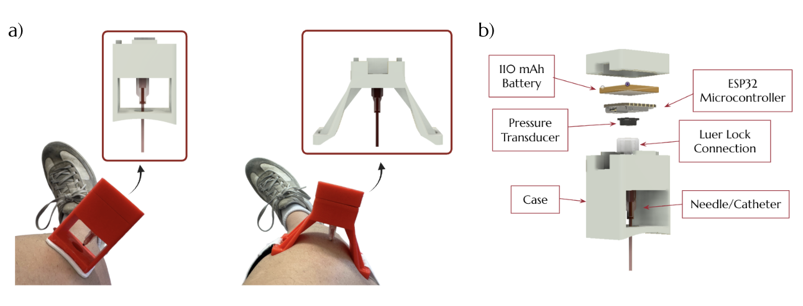
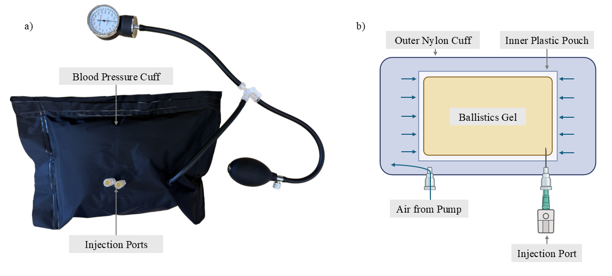

<!-- Condensed from the HardwareX manuscript. Edit freely. -->

## Compartment syndrome

Acute compartment syndrome is an orthopedic emergency. After a fracture, burn or penetrating wound, bleeding and swelling raise the pressure inside a muscle's fascial compartment. The fascia can't expand, so within minutes to hours the pressure collapses the blood vessels and the tissue starts to die. It follows about 2.7% of tibial fractures, the most common single cause.

Normal compartment pressure is around 10 mmHg. Above 30 mmHg the standard treatment is an emergency fasciotomy, which leaves large scars and carries a high risk of infection. The first sign is usually pain out of proportion to the injury, which a nerve block can hide, so a diagnostic tool has to resist both false positives and false negatives.

Two devices are used clinically in the US. The Stryker STIC monitor takes one reading per needle insertion. The MY01 monitors continuously for up to 18 hours, but it is single-use and costs about $3,250 per use. Neither one fits military field hospitals or rural trauma centers, where compartment syndrome is common and budgets are tight.

## The device

The core is three off-the-shelf parts: a Seeed Studio XIAO ESP32-C6, a Honeywell ABP2 gauge pressure transducer with a built-in amplifier and ADC, and a LiPo battery. A Luer-lock plug glued onto the transducer lets any standard needle or catheter twist on. Once the needle is in the muscle, the fluid in it couples the compartment pressure to the sensor.

The ESP32 reads the sensor over I²C, logs the data locally, and sends it over Bluetooth to an iPhone app. Two 3D-printed cases suit different patients: an adhesive patch that is quick to put on, and a strapped version for burns or damaged skin where adhesive isn't safe.

The app plots the pressure trend and lets the clinician set an alarm threshold (30 mmHg by default). When the pressure crosses it, the phone sounds a loud alarm and vibrates. A rolling average keeps single outliers from triggering false alarms. The device samples once a minute to save battery, and the data can be exported as a CSV for research.

## Validation

The first test used a tissue phantom: ballistics gel sealed in an inelastic pouch that plays the part of the fascia, with a self-healing injection port, all wrapped in a blood pressure cuff. With a 20 G catheter in the gel, inflating the cuff produced an immediate, stable reading that rose linearly with the applied pressure.

The phantom isn't a precise pressure reference, so accuracy was measured on a hydrostatic water column, where the pressure is known exactly from ρgh. The water height was stepped from 60 cm down to 1 cm in 1 cm increments, with three trials each for an 18 G needle and a 20 G catheter.

Both setups tracked the theoretical pressure closely (R² = 0.9995 for the needle and 0.9993 for the catheter). The mean absolute error was 1.13 mmHg for the needle and 0.72 mmHg for the catheter. A t-test showed a small systematic offset, most likely from calibration, and no significant difference between needle and catheter.

| Requirement | Target | Achieved |
|---|---|---|
| Pressure range | 0–60 mmHg | 0–60 mmHg |
| Accuracy | ±1 mmHg | ±2.2 mmHg |
| Sampling rate | 1 sample/min | 1 sample/min |
| Mass | < 50 g | 42 g |
| Penetration depth | 5–50 mm | 5–50 mm |

## Open hardware

The case CAD, ESP32 firmware and iOS app are released under a CC BY-NC license, so anyone can build the device from the bill of materials. Beyond clinical use, it is meant as a research platform: a cheap, reproducible way to record compartment pressure in experimental models and field studies, and a source of ground-truth data for validating non-invasive detection methods such as near-infrared spectroscopy, surface strain sensing and biomarkers.

## Next steps

The device hasn't yet been tested in humans or animals. Next come a calibration step to remove the systematic offset, then animal and clinical testing.

