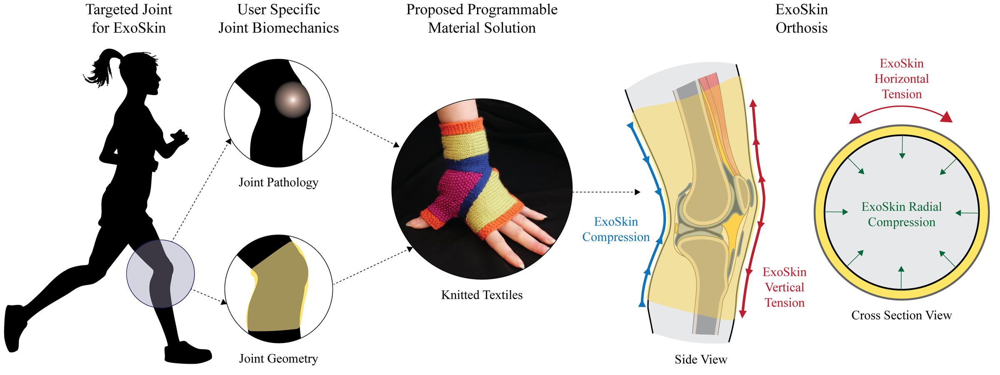
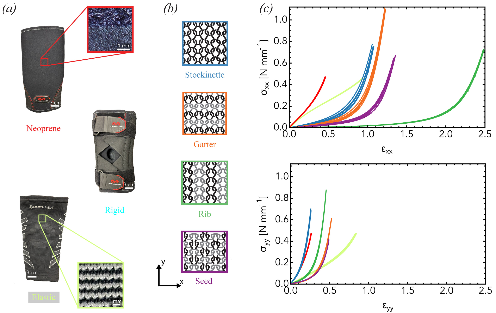
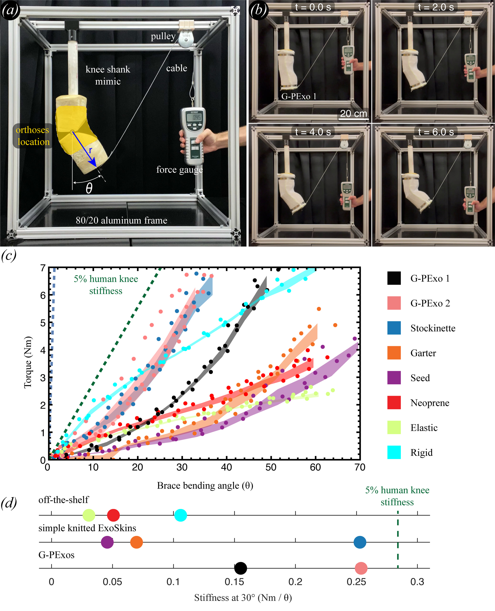
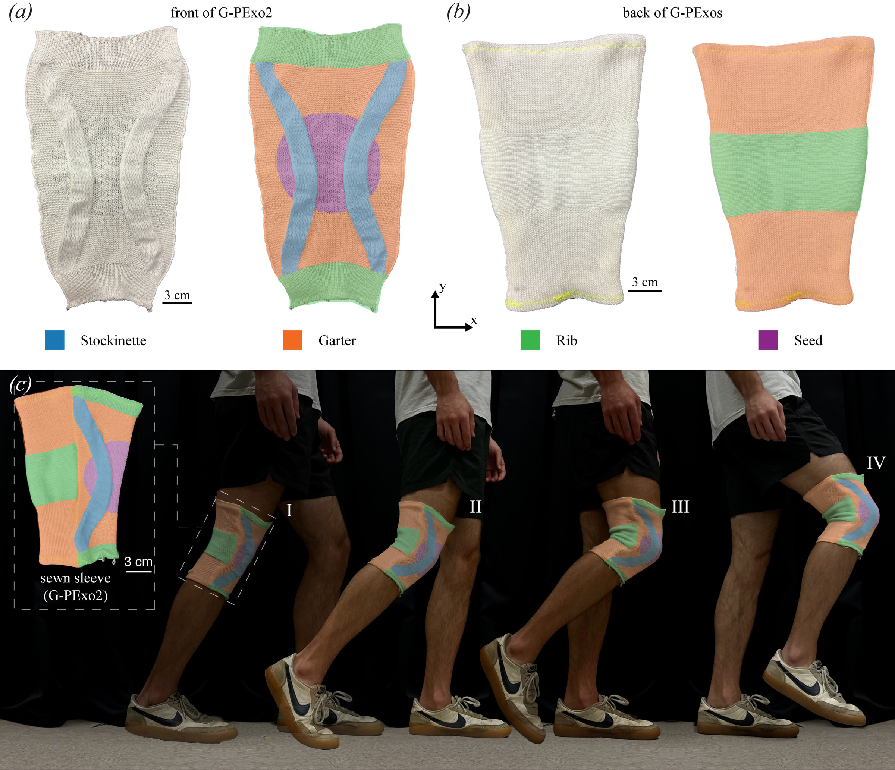

<!-- Condensed from the paper (arXiv:2509.22971). Edit freely. -->

## Knit as a programmable material

Knee problems are common. There are nearly 200,000 ACL injuries a year in the US, and the lifetime risk of symptomatic knee osteoarthritis may be as high as 45%. Off-the-shelf braces use a one-size-fits-most design: elastomer or neoprene that stretches over many legs and compresses them all uniformly. Poor fit, discomfort, bulk and cost are among the main reasons people stop wearing them.

ExoSkins are a class of unpowered, garment-like exoskeletons designed around a user's joint. In this work they are made only from knitted fabric, using a nearly inextensible acrylic yarn, so all of the mechanics come from stitch geometry. Combining the two basic stitches, knit and purl, gives four fabrics with very different anisotropic properties: stockinette, garter, rib and seed. An industrial knitting machine can place them anywhere in a seamless garment.

## Swatch mechanics

Uniaxial tension tests on fabric swatches showed the contrast. The knits are strongly anisotropic and stiffen sharply once the yarn goes taut, while the commercial brace materials behave almost the same in both directions. Around the leg, the commercial materials were more than four times stiffer than stockinette and garter, and an order of magnitude stiffer than rib and seed, so knits are easier to pull on and squeeze the leg less. Along the leg, the direction that resists knee bending, the two groups cover a similar range.

Swatch data alone didn't predict how a whole orthosis behaves on a bending knee, so the orthoses had to be tested on one.

## Knee-flexion test rig

I built a rig that bends a replica knee. A plaster cast of a leg was filled with rigid foam around a PVC core, cut at the knee and rejoined with a 3D-printed hinge, then trimmed behind the knee to allow about 70° of flexion. The thigh is fixed to a T-slot frame. A braided steel cable runs from the shank over a pulley to a handheld force gauge, and pulling down on the gauge bends the knee.

Each test is filmed. From each trial I extracted 15 frames, measured the angle and moment arm in MATLAB, and computed torque from the force reading. Three trials gave 45 points per orthosis. After subtracting a no-orthosis baseline for the rig itself, I fit each response and took its stiffness at 30°. I tested eight orthoses in total: three commercial braces (neoprene, elastic and rigid), three single-stitch ExoSkins, and the two G-PExos described below.

## Results

The commercial braces respond almost linearly. Every knitted ExoSkin starts soft and then stiffens with angle, and the stitch pattern sets where that happens. At 30°, the rigid brace reaches about 2% of human knee stiffness, while the stockinette ExoSkin reaches about 4.5%. Garter and seed fall in the same range as the commercial braces. None of the orthoses tested reached 5%.

## Geometrically programmed ExoSkins

The G-PExos combine all four fabrics in one sleeve. Two curved stockinette stripes run from thigh to shank around the kneecap and carry most of the load. Seed sits over the kneecap for flexibility, rib forms the cuffs so the sleeve stretches on easily, and garter fills the rest. The back panel is mostly garter, with rib behind the knee to prevent bunching; it is knit separately and rotated 90° so the fabric's stretchier axis runs along the leg.

The two designs differ only in stripe width: 0.8 cm for G-PExo1 and 1.75 cm for G-PExo2. With only 8% of its front panel in stockinette, G-PExo1 reaches about 4% of knee stiffness, more than any commercial brace tested. G-PExo2, with 20% stockinette, matches the all-stockinette sleeve while keeping mostly garter and seed for comfort. Both sleeves have the same size and fit, so the geometry tunes stiffness without tightening the whole garment.

## Next steps

- Optimize the stitch map from a user's measured biomechanics rather than designing it by intuition.
- Use stiffer or active yarns, and knit the sleeves seamlessly to cut out sewing.
- Measure compression, which this rig couldn't, and long-term stress relaxation.
- Test with users, likely as a clinical trial.
