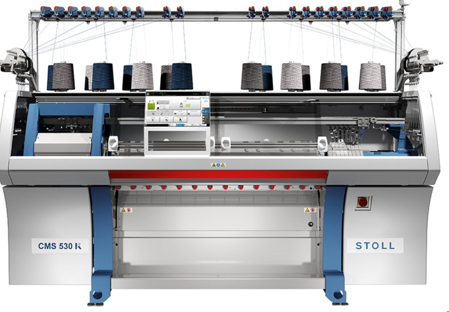
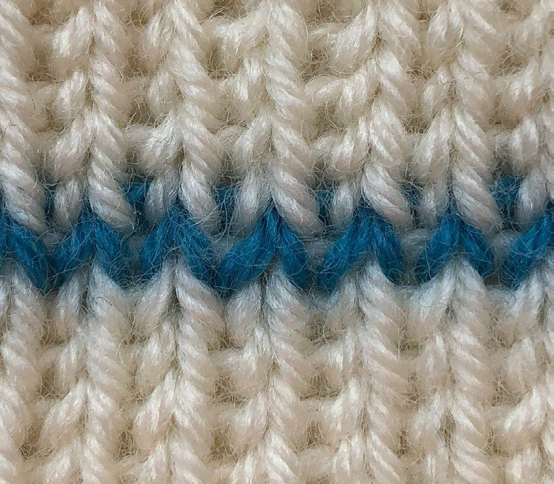
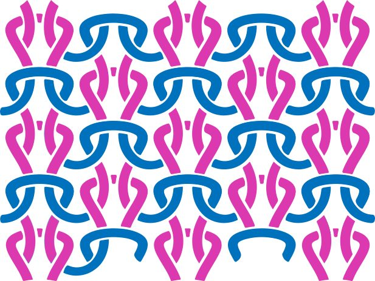
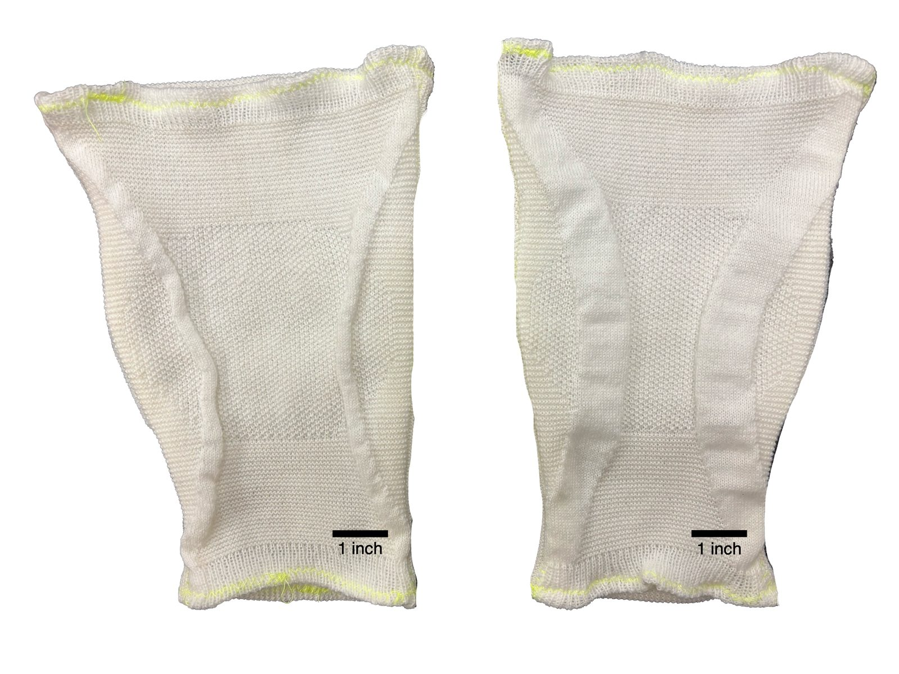
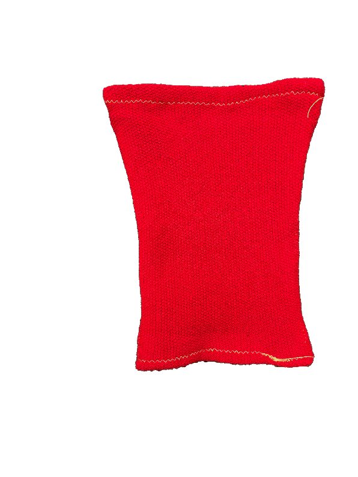
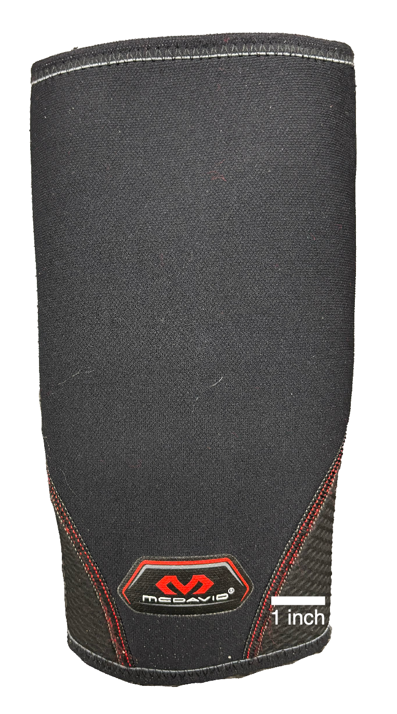
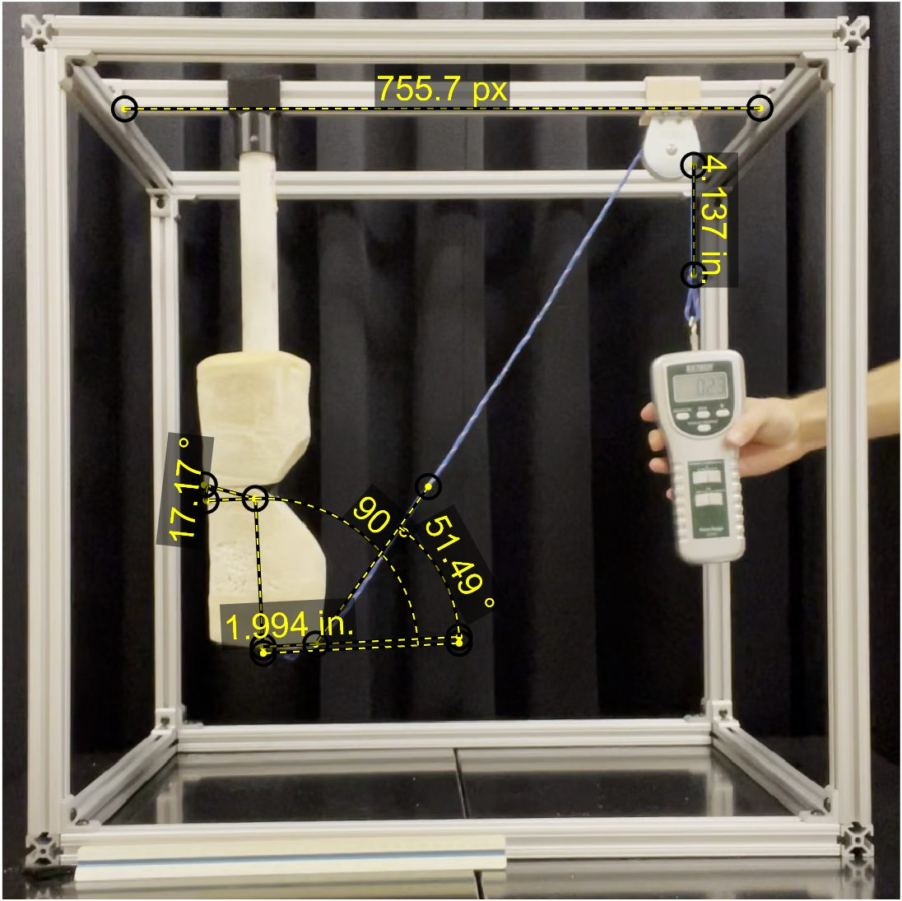
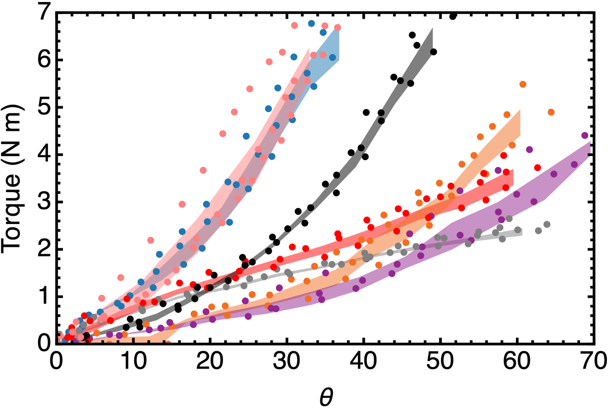
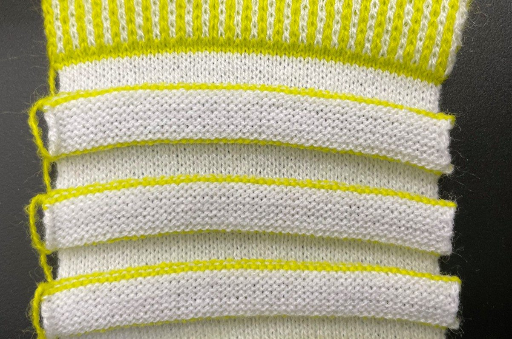

<!-- Draft carried over from the old site. Rewrite in your own words. -->

## Knit as a programmable material

Commercial braces come in small, medium and large. Bodies don't. Knitting machines can vary stitch pattern continuously across a garment, so a knee sleeve could in principle be **programmed, stitch by stitch, to deliver a prescribed torque-angle response** for one person's joint. Before you can optimize that, you need to know how elementary stitch patterns behave on a joint.

This work produced the first characterization of knitted ExoSkins for bio-augmentation and became a co-first-author paper, [arXiv:2509.22971](https://arxiv.org/abs/2509.22971).

## Experimental design

I designed and built a torque-angle rig around a foam cast of a human leg, hinged at the knee. We tested three single-stitch ExoSkins (stockinette, garter, seed), two multistitch ExoSkins, and three commercial braces (elastic, neoprene, rigid).

- Force applied through a force gauge while video captured rotation and readings together.
- Frames extracted and measured in MATLAB: 15 torque-angle points per trial, 3 trials per garment.
- Results benchmarked against published quasi-stiffness of the knee during walking.

## Results

ExoSkins stiffen progressively with knee angle, while commercial braces stay nearly linear. The stitch geometry shapes the response curve.

Even the stiffest garments contribute only about 2–5% of walking knee stiffness. That reframes the goal: the value of knits isn't brute stiffness, it's **programmability**, tuning where and how resistance builds through the range of motion.

## Optimization-based design

The roadmap pairs this foundation with modeling and optimization: measure a user's joint impedance, solve for the stitch map that complements it, and knit the orthosis directly. Alongside the rig work I ran human biomechanics characterization (motion capture, EMG, torque-angle testing) to feed that framework.

