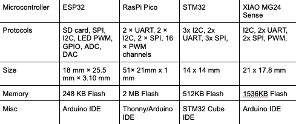
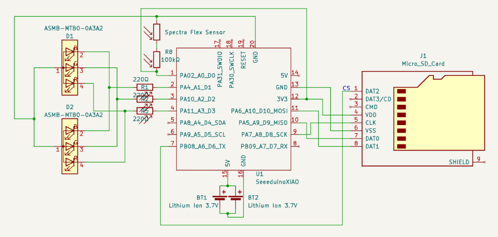

<!-- Draft carried over from the old site. Rewrite in your own words.
     No photos of the real hardware or fish yet. Add some if you have them.
     The old "concept sketch" and "iterations" images were the same table (one is in _unused/). -->

## Tracking fish in the wild

We understand fish locomotion mostly from short camera clips in lab tanks. That breaks down in the low-light, turbid environments fish actually live in, and existing tracking either pierces the fish or is tied to a fixed camera. As exoskeleton lead on Team ExoTic, my job was a harness that carries real sensing without changing how the fish swims.

## Body-conforming harness

The 5%-of-body-weight limit drives everything. To fit the shape of a largemouth bass, I started from a 3D mesh scan, lofted cross-sections in SolidWorks into a body-conforming shell, then removed material to leave the lightest structure that still carries the electronics.

- A weighted concept-selection matrix across manufacturing methods, fasteners and size adjusters picked SLA flexible resin with external adjustable fasteners.
- Dog-bone specimens of Formlabs Elastic 50A and Flexible 80A at 1.0, 1.5 and 2.0 mm. **Flexible 80A at 1.5 mm** won on tear resistance (8.9 vs 3.4 MPa UTS) at acceptable flexibility.
- Three major CAD revisions moved the microcontroller and SD reader ventrally, LEDs dorsally for visibility, and batteries near the center of mass.

## Sensing and electronics

Two flex sensors along the lateral line measure body curvature. A 6-DOF IMU on the XIAO MG24 Sense captures acceleration and rotation. Data logs to a microSD card while dorsal RGB LEDs show curvature in real time.

## Results

The team delivered a working proof of concept, validated for testing in Prof. Liao's lab. As finance manager I held development cost to **$236** against a $24k commercial-equivalent estimate. The design is meant as an open, expandable platform for marine biomechanics.
