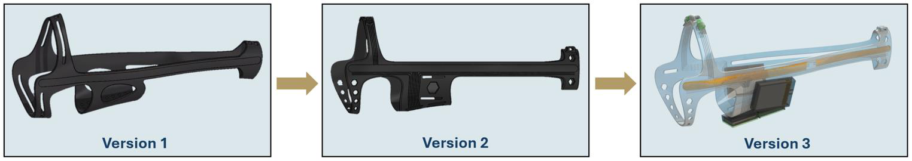
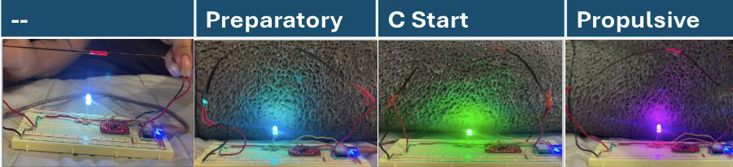

<!-- Condensed from the capstone report "A Smart and Non-Invasive Exoskeleton to Track Fish Biomechanics". Edit freely.
     No photos of the real hardware on a fish yet. Add some if you have them. -->

## Tracking fish in the wild

No robot is as efficient, fast and adaptable underwater as a fish, but most of what we know about how fish swim comes from short video clips in lab tanks. Cameras fail in the dark, deep or murky water where fish actually live. Tags give position but are usually anchored through the fin or musculature, and they say little about body motion. Radio signals fade quickly in water, so any onboard system has to store its data locally until the fish is recaptured.

Our capstone team, ExoTic, built a form-fitting exoskeleton for largemouth bass that measures body curvature and motion, logs it, and shows posture in real time with RGB LEDs, without changing how the fish swims. A common rule is that an attachment must weigh less than 5% of the fish's body weight to leave swimming unaffected, and that limit drove every design choice. I led the exoskeleton design and managed the budget.

## Body-conforming harness

We scored three harness concepts in a weighted selection matrix: SLA-printed flexible resin, FDM-printed TPU, and nylon straps with printed connectors. SLA resin won, with external fasteners that adjust for size. TPU is cheaper and more accessible, but stiffer and less precise. Fabric is the lightest option but hard to integrate with sensors.

To match the fish's shape, I started from a 3D mesh scan of a largemouth bass. In SolidWorks I lofted cross-sections along its length into a body-conforming solid, shelled it thin, and cut material away to leave the lightest structure that still holds the electronics. The harness opens along the top to slip over the fish and closes with zip ties through built-in attachment points.

Each iteration responded to prototyping and to what the electrical subsystems needed. The microcontroller and SD reader moved to the belly, away from sensitive regions. The LEDs moved to the back for visibility, and the two batteries were balanced on either side near the center of mass.

To choose the material, I printed dog-bone specimens of Formlabs Elastic 50A and Flexible 80A at 1, 1.5 and 2 mm, then flexed and stretched them to simulate the loads on and off the fish. Elastic 50A was more flexible but tore at stress concentrations (3.4 MPa ultimate tensile strength). Flexible 80A was stiffer but far tougher (8.9 MPa). Because the shell is so thin, durability won: **Flexible 80A at 1.5 mm**.

## Sensing and electronics

Two flex sensors run along the fish's lateral line to measure body curvature. The Seeed Studio XIAO MG24 Sense was chosen for its built-in 6-DOF IMU, which records acceleration and rotation without adding an external board. Data logs to a microSD card at 10 Hz, about 43 MB a day, so a 1 GB card holds roughly 23 days of continuous recording. The curvature reading drives PWM signals to RGB LEDs on each side, so the fish's posture is visible at a glance. Two LiPo cells in parallel give 800 mAh, about 7 to 15 hours depending on activity. The electronics housings are sealed with marine-grade sealant.

## Testing

Manual bending tests produced a resistance-to-bend-angle calibration, and the readings were stable enough to convert reliably into curvature. The LEDs changed colour with posture, and the IMU logged distinct traces at rest, in burst-to-steady swimming, and in steady swimming. The main problem was flicker in the LED output, which appeared after the switch from the 10-bit SAMD21 to the 12-bit MG24 and most likely came from sensor noise or timing mismatches.

The development cost was **$236**, compared with an estimated $24,300 for a commercial team once labor is included. The unit manufacturing cost is $101. Built from off-the-shelf parts and open-source code, the system is meant to be something a university lab can make itself.

## Next steps

The exoskeleton hasn't been tested on a live fish yet. That would happen in Prof. Liao's lab at the Whitney Laboratory for Marine Bioscience. Next come filtering to stabilize the sensor and LED outputs, deep-sleep firmware for longer battery life, a flex PCB to replace the hand wiring, versions for other species, and more sensors such as electrodes for muscle activity.
