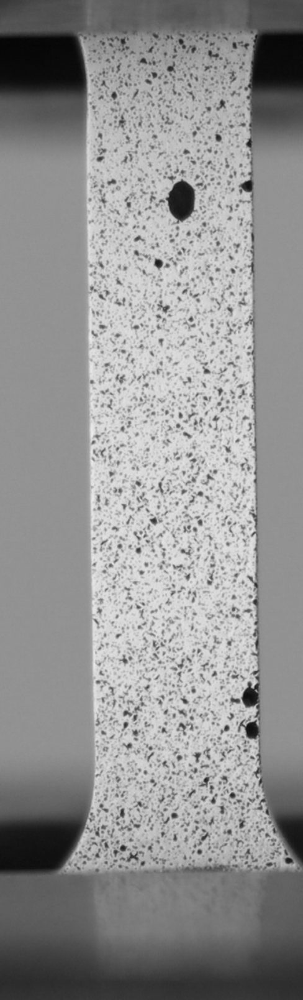
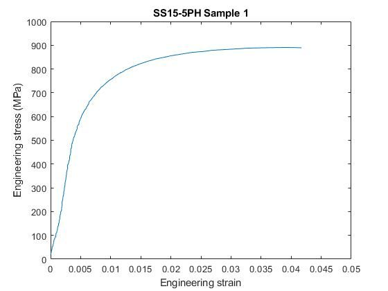
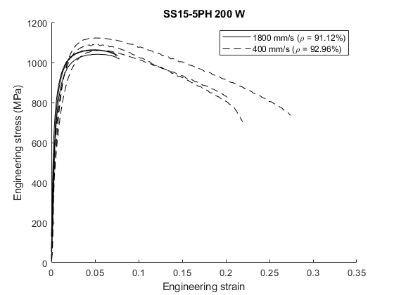

<!-- Draft carried over from the old site. Rewrite in your own words. -->

## Process, porosity and strength

Metal additive manufacturing trades the predictability of wrought stock for design freedom, but process parameters leave behind internal porosity that drives where and how a part fails. To use AM structurally, you have to connect **process → porosity → mechanical behavior** with real data.

## Mechanical characterization

I ran tensile tests on 15-5PH stainless specimens printed across a range of process parameters, capturing full-field deformation with digital image correlation instead of a single extensometer.

- Reconstructed stress-strain curves and Eyy strain fields from speckle-tracked video.
- Extracted modulus, yield and ultimate strength, and compared parameter sets to isolate process effects.

## Porosity analysis

To explain the scatter, I wrote a MATLAB pipeline that segments pores in cross-sectional micrographs, quantifying size, count and distribution so porosity can be correlated with measured strength and failure location.
