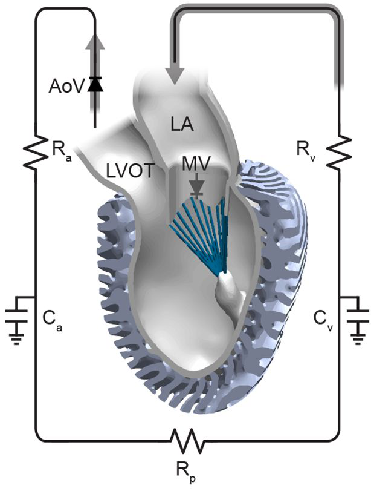
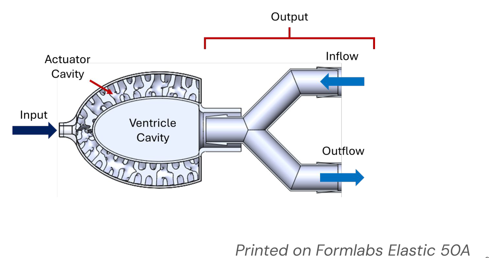
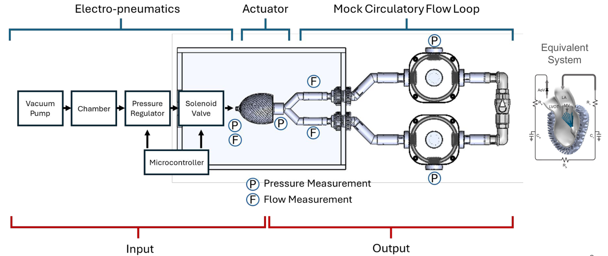
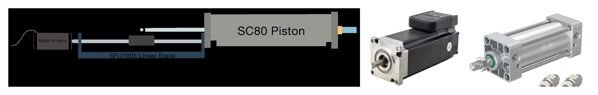
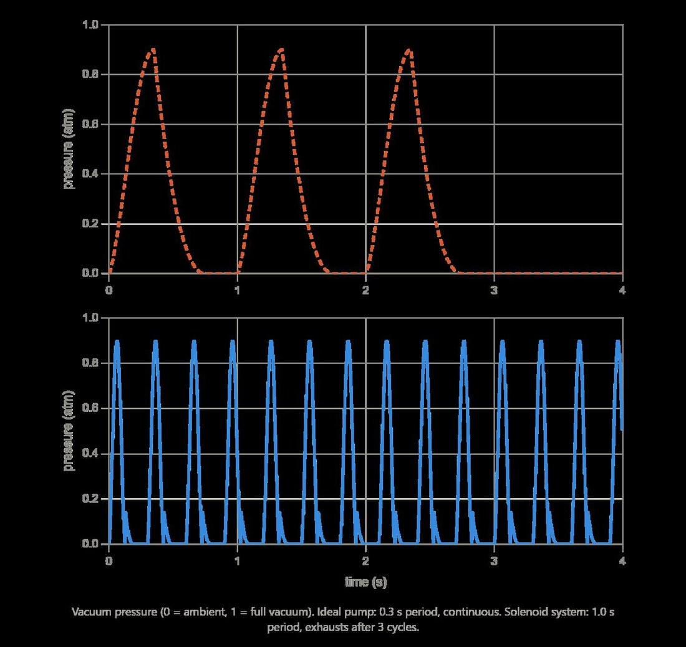

<!-- Draft carried over from the old site. Rewrite in your own words. -->

## Metamaterial ventricle

The plant is a soft robotic ventricle printed in Formlabs Elastic 50A, developed in prior work from the Roche lab. A metamaterial lattice forms the ventricle wall. Evacuating the actuator cavity between the lattice and the inner membrane squeezes the ventricle and ejects fluid, mimicking systole.

The ventricle sits in a mock circulatory loop, with compliance chambers and resistances standing in for the arterial and venous beds, so its input/output behavior maps onto the equivalent circuit cardiologists use to model the real heart.

## Instrumentation

We instrumented the loop end to end: PendoTECH pressure transducers at the actuator and loop inputs and outputs, read through NAU7802 24-bit ADCs (gain 128 on a 0–25 mV bridge signal) multiplexed over I²C into an Arduino Nano Every at 320 samples per second, plus Transonic perivascular flow sensors on the inflow and outflow lines.

## Hydraulic piston drive

The original drive was pneumatic: a vacuum reservoir, regulator and solenoid valve pulsing the actuator cavity. For system identification that has a basic flaw. Air is compressible, so you can command pressure but never know the *volume* you delivered. It also topped out around 30 L/min and could not run continuously.

I designed and built the replacement, a **servo-driven hydraulic piston pump**. A NEMA 23 integrated servo (iSV57T-130S) drives an SFU1605 ball-screw stage, which strokes an SC80 pneumatic cylinder repurposed as a water piston, all on a 2020 T-slot frame. Water is incompressible, so commanded displacement *is* delivered volume.

- **Displacement control** instead of pressure control: the input becomes a known volume waveform.
- **50 L/min** flow, up from about 30 L/min.
- **Continuous operation**: no reservoir to deplete, so long identification runs and fatigue cycling are possible.
- Sized from torque-speed curves against the pressure-volume demands of the ventricle.

## System identification

A soft cardiac simulator is only useful to clinicians and device designers if its dynamics are characterized. With known input volume and measured pressures and flows on both sides, the MATLAB identification pipeline can fit the equivalent-circuit parameters of the ventricle and loop.

> Choose the actuation modality that makes your states observable.
