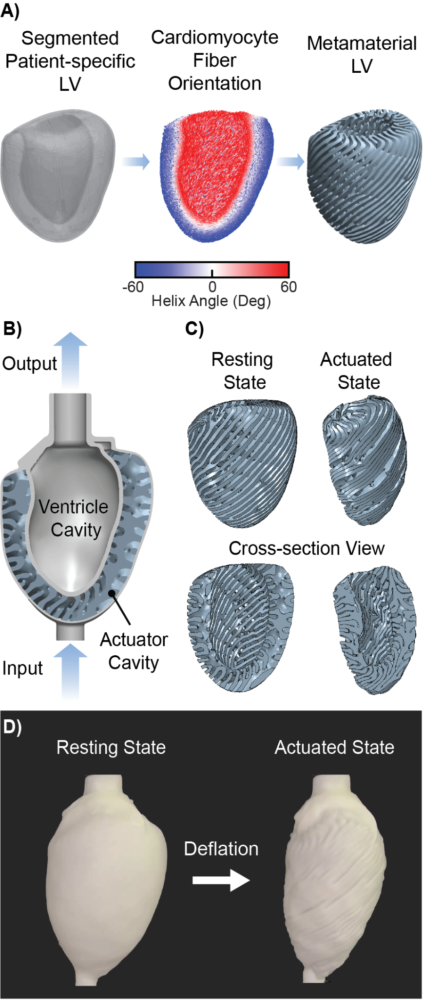
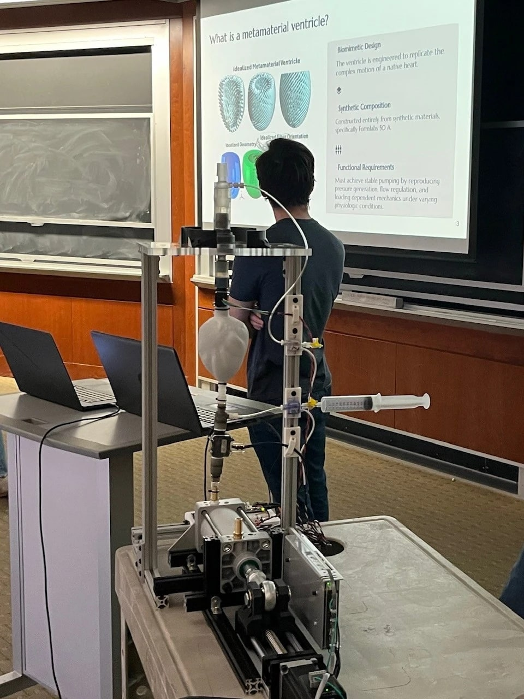
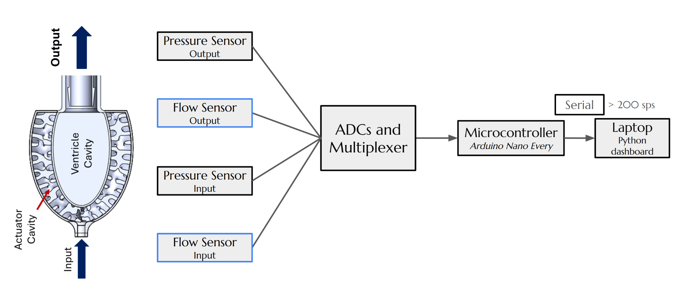
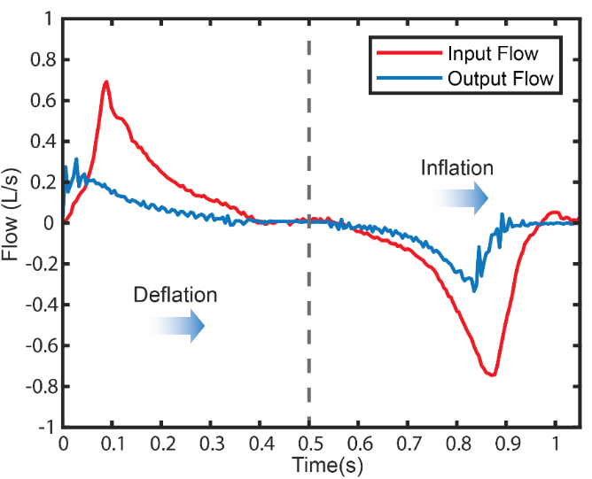
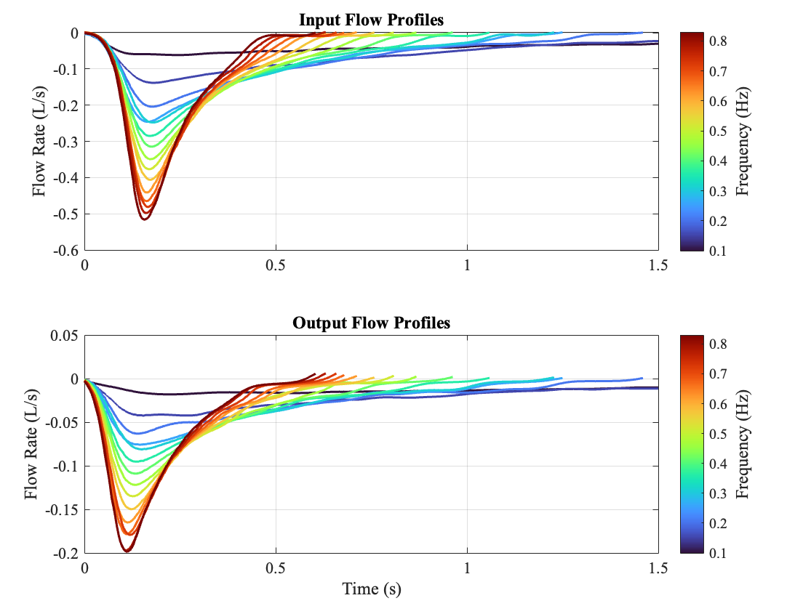
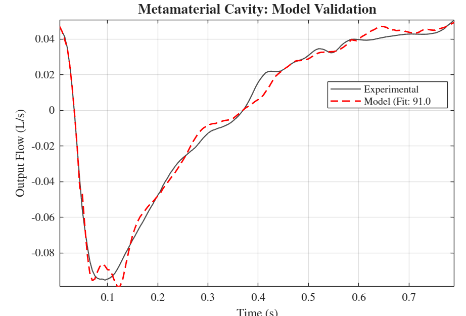
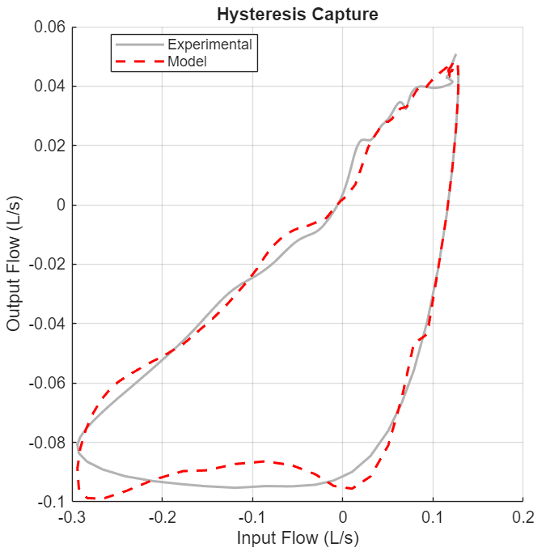

<!-- Condensed from the 2.131 paper "System Identification of a Metamaterial Heart". Edit freely. -->

## Metamaterial ventricle

Nearly 30% of patients on the heart transplant list die or become too ill for surgery within a year of waiting. An artificial ventricle has to do more than move fluid: it must reproduce the heart's pressure generation, flow regulation and response to load. Architected metamaterials are a promising route because their programmed structure can tune those mechanics in ways a plain elastic shell can't.

The ventricle starts from a segmented MRI scan of a patient's left ventricle. A rule-based algorithm assigns idealized muscle-fiber orientations (helix angle +60° to −60°), and a procedural texturing method fills the wall with a fiber-like lattice that is rigid along the fibers and flexible across them. The lattice is printed in Formlabs Elastic 50A and cast between two PVA cryogel shells, forming a ventricle cavity and a surrounding actuator cavity. Pulling volume out of the actuator cavity collapses the lattice across the fibers, squeezes the ventricle and ejects fluid, mimicking how cardiac muscle contracts.

## Piston pump

My contribution to the project was the pump that drives the ventricle. I designed, built and programmed it.

### Why a piston

The original drive was a vacuum reservoir switched by a pneumatic controller. It controlled pressure, not volume, and because air is compressible there was no way to know how much volume actually went into the actuator. It also topped out around 30 L/min and could only run a limited number of cycles before the reservoir needed recharging. For system identification the input has to be known precisely, so I replaced it with a displacement-controlled piston. The motor's position sets the swept volume directly, the pump runs continuously, and the design targets 50 L/min.

### Sizing

The design targets came from adult physiology: a 200 mL stroke volume, 50 L/min peak flow and 1 atm of vacuum, across 60–120 BPM. It is a single-stroke pump, so one stroke maps to one heartbeat with no valves or gearing between them. The piston's flow follows directly from the motor's speed:

Q = A · (lead / 2π) · ω

An 80 mm bore gives a piston area of about 5,030 mm². A 5 mm lead turns the servo's 3000 RPM ceiling into 250 mm/s of piston travel, which works out to a theoretical peak of about 75 L/min, comfortably above the 50 L/min target. At 1 atm of vacuum the piston pulls roughly 510 N, which the 5 mm lead brings down to about 0.45 N·m at the motor, inside the servo's 0.6 N·m rated torque. I sized the servo from its torque-speed curve against these loads.

### Mechanical design

The drive train is an iSV57T-180S integrated servo (180 W, 0.6 N·m rated and 1.1 N·m peak, 16-bit encoder) on an SFU1605 ball-screw stage, pushing an SC80 pneumatic cylinder repurposed as the piston. The cylinder rod connects to the carriage through a heim joint and a double-ear clevis bracket, so small misalignments between the screw and the cylinder don't bind the rod. Everything mounts to a 2020 T-slot frame, and the cylinder ports take brass hose barbs, so the same pump runs on water or air. Water is incompressible, so the displaced volume is exactly known, but its inertia limits how fast the pump can cycle. The tests reported here ran on air with an 80 mm stroke, at up to 2 Hz (120 BPM). The whole pump, including the power supply and electronics, came in at about $390 in parts.

### Control

The servo closes its own position loop. An Arduino Nano generates the step and direction pulses, recomputing the target position and velocity of the waveform every 500 µs. A MATLAB GUI sets the parameters, runs frequency sweeps and plots position, velocity and flow live. Both the firmware and the GUI reject any command whose peak velocity would exceed the step-rate limit, and soft limits stop the piston before the end of its travel. The pump plays back sinusoids for the identification sweeps, and trapezoidal velocity profiles, run closed-loop through the manufacturer's tuning software, for broadband tests.

## Instrumentation

PendoTECH pressure sensors are read by two 24-bit NAU7802 ADCs, and flow is measured by a Sensirion SFM3003 mass flow meter and an ES Systems ESRF-ESF MEMS sensor. The SFM3003 has a hardcoded I²C address that clashes with the ADCs, so a TCA9548A multiplexer sits between them and an Arduino Nano Every. The ADCs top out at 320 samples per second, and the full system reached about 250. A multithreaded Python script logs the serial stream to CSV while updating a live dashboard, and the data are resampled onto a uniform time base afterwards.

## System identification

We first tried broadband identification: a pseudo-square-wave velocity input, with the frequency response estimated by Welch's method. The spectra showed harmonics a linear system wouldn't produce, and coherence stayed below 0.5 across most of the band, so we switched to steady-state sine inputs at discrete frequencies from 0.2 to 1 Hz.

A lumped spring-mass-damper can't capture the ventricle: every lattice cell has its own mass and elasticity, which makes the wall a distributed system with high-order lag and subtle resonances. The data were fit with a multi-input, single-output Hammerstein-Wiener model, a static input nonlinearity, then a linear dynamic block, then a static output nonlinearity. Its inputs are the input flow, its derivative and its integral (the cavity volume). In the identified model, an 11th-order flow term captures structural resonances in the lattice, a 3rd-order rate term captures viscoelastic damping, and a 3rd-order volume term captures how the material stiffens as the cavity fills.

The model was trained on 80% of the recordings. On the held-out 20% it reached a **91% fit**, and it reproduces the ventricle's hysteresis. The area inside that loop is energy lost to friction in the elastomer and viscous losses in the fluid. Residual cross-correlation stayed within the 95% confidence bounds, a sign that the model captures the real input-output dynamics rather than overfitting individual recordings.

## Next steps

The 91% model predicts well, but its high order makes it hard to interpret physically. The next model will have fewer terms, each tied to a physical mechanism such as fluid inertance, flow resistance or tubing compliance. Switching both the actuation and circulatory sides from air to water will isolate the metamaterial's own nonlinearity. Connecting the ventricle to a mock circulatory loop with realistic vascular resistance and compliance would then make it a testbed for medical devices.
