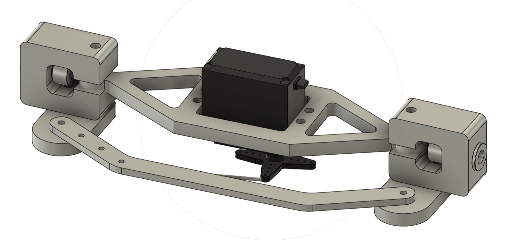
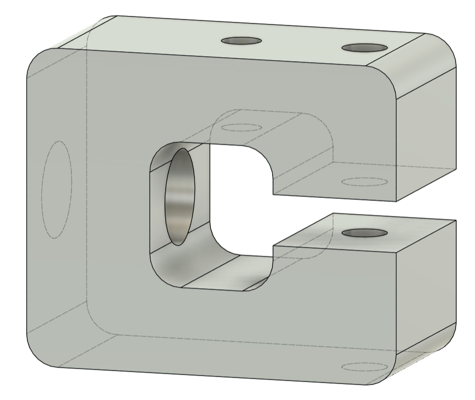
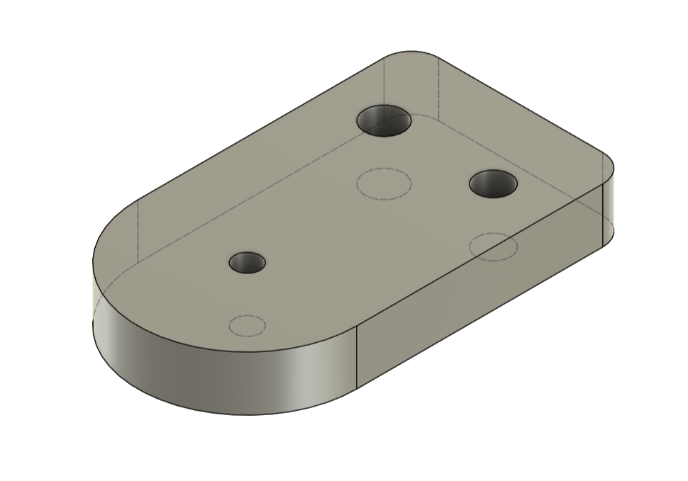
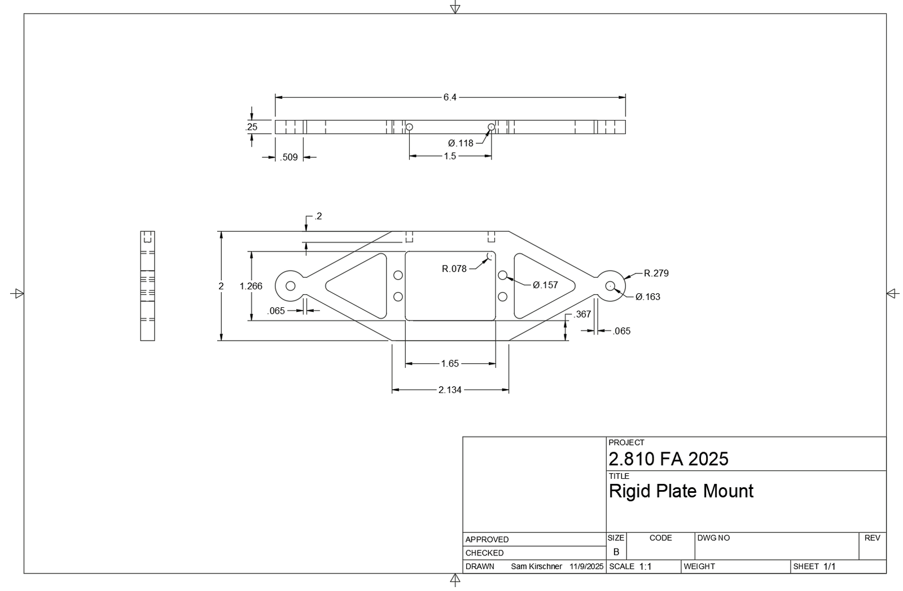
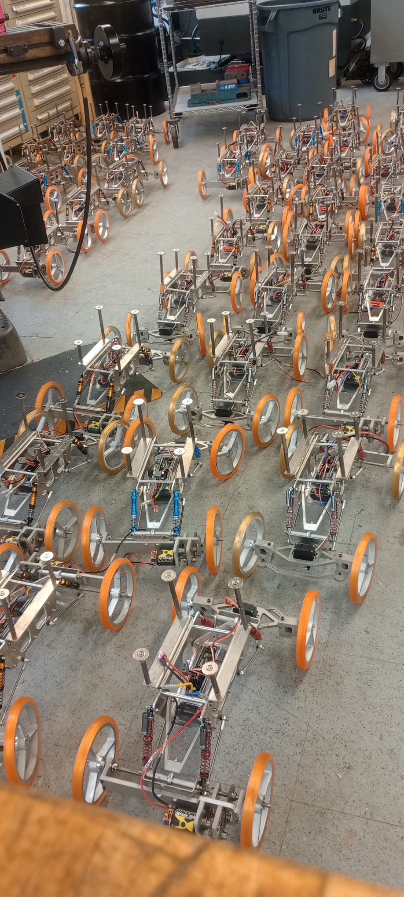

<!-- Draft carried over from the old site. Rewrite in your own words. -->

## From design review to manufacturing review

The inherited steering design worked, but it relied on expensive parts, 3D-printed or complex machined geometry, and unreliable press fits and adhesives. The assignment: take it from "prints on a desktop" to "produces consistently in a shop."

## DFM principles

Across the eight unique components (plate mount, rigid linkage, C-joint, steer bars, bushings, shaft collars, wire and servo) we applied one philosophy:

- **Flatten to 2D.** Complex 3D geometry re-modeled as flat profiles cut on the waterjet and assembled with simple fasteners.
- **Machine only critical features.** Tolerance and machine time spent on bushing bores and mating faces, not cosmetic surfaces.
- **Standardize joining.** Bolted connections instead of press fits and adhesives wherever possible.
- **One material.** Aluminum plate stock for predictable, repeatable machining.

## Process planning

Each part got an explicit operation sequence. The plate mount: waterjet the profile and holes, drill the top holes to tolerance, face the back edge on the mill, then drill and tap.

The C-joint is the showcase part: waterjet profile, face front and back, drill and ream the bushing bore, face the interior surfaces, then press-fit and ream the bushing to final size. Each datum is established before the features that depend on it.

## Takeaway

Every feature on a drawing is a real operation with a real cost. Good design moves cost off the part by choosing processes deliberately.

